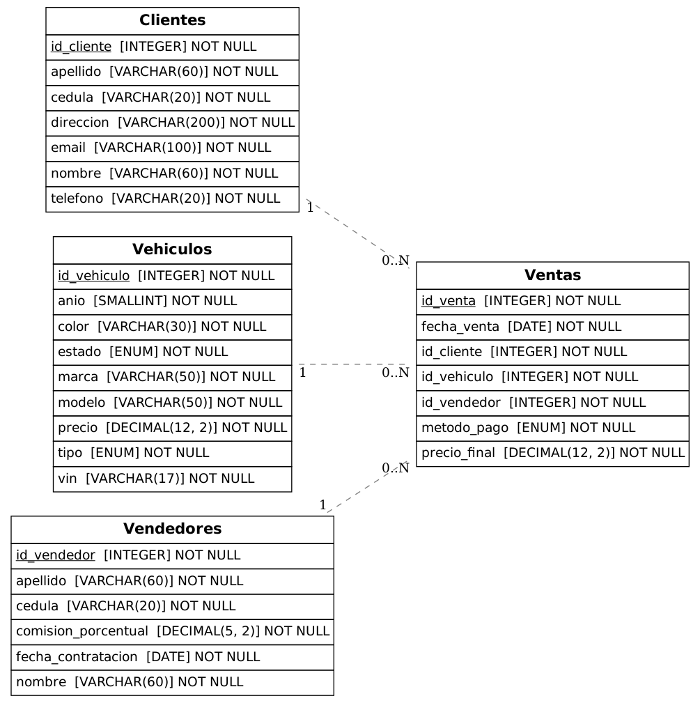

# Quiz #5 — SQL: MiAutoPuntoCom

**CE 2103 — Algoritmos y Estructuras de Datos II**  
**Instituto Tecnológico de Costa Rica — Escuela de Ingeniería en Computadores**

Base de datos relacional en MySQL para el sistema de información de la empresa **MiAutoPuntoCom** (gestión de inventario y venta de vehículos). Cubre de forma íntegra las **4 partes** solicitadas: creación de tablas normalizadas, restricciones e integridad referencial, carga de datos de prueba y consultas analíticas.

## Diagrama entidad-relación



*Nota: el diagrama se generó automáticamente a partir de las tablas creadas en MySQL y dibuja la relación Vehículos–Ventas como 1 a muchos por defecto. En la práctica funciona como 1 a 1, ya que `id_vehiculo` tiene una restricción `UNIQUE` en `Ventas` para evitar vender el mismo vehículo más de una vez.*

## Decisiones de diseño

| Tabla | Decisión | Por qué |
|---|---|---|
| **Vehiculos** | `vin` es `VARCHAR(17) UNIQUE` | El VIN real mide 17 caracteres y es único por definición. |
| **Vehiculos** | `anio` en vez de `year` | `YEAR` es una palabra reservada en SQL. |
| **Vehiculos** | `precio` es `DECIMAL(12,2)` | Evita errores de precisión de punto flotante (`FLOAT`) al manejar montos de dinero. |
| **Vehiculos** | `tipo` y `estado` son `ENUM` | Restringe los valores a las listas cerradas del negocio (`Nuevo`/`Usado` y categorías de vehículo). |
| **Clientes / Vendedores** | `cedula` y `email` son `UNIQUE` | Impide registros duplicados de personas o correos en el sistema. |
| **Vendedores** | *Trigger* `trg_validar_edad_vendedor` | Verifica mediante `TIMESTAMPDIFF` que todo vendedor tenga al menos 21 años al momento de su contratación. |
| **Ventas** | Llaves foráneas (`FK`) a las otras 3 tablas | Garantiza la normalización e integridad referencial (`ON UPDATE CASCADE ON DELETE RESTRICT`). |
| **Ventas** | `id_vehiculo` es `UNIQUE` | Asegura que un vehículo no pueda ser vendido dos veces. |
| **Ventas** | `metodo_pago` es `ENUM` | Limita las opciones de pago a `'efectivo'`, `'financiamiento'` o `'tarjeta'`. |
| **Todas** | Restricciones `CHECK` | Evita datos inválidos: años fuera de `1900–2026`, precios `<= 0` y comisiones fuera del rango `0%–20%`. |

## Estructura del repositorio

```text
.
├── README.md
├── sql/
│   ├── 01_schema.sql           # DDL: base de datos, tablas, constraints y trigger (Partes 1 y 2)
│   ├── 02_datos_ejemplo.sql    # DML: 10 vehículos, 6 clientes, 4 vendedores y 8 ventas (Parte 3)
│   └── 03_consultas.sql        # Consultas SQL de negocio y reportes (Parte 4)
└── diagrama/
    └── er_diagram.png
```

## Cómo ejecutarlo

**Requisitos:** MySQL Server 8.0+ y MySQL Workbench (o cliente de línea de comandos).

### Opción 1: Desde terminal
```bash
mysql -u root -p < sql/01_schema.sql
mysql -u root -p < sql/02_datos_ejemplo.sql
mysql -u root -p < sql/03_consultas.sql
```

### Opción 2: Desde MySQL Workbench
1. Abrir `sql/01_schema.sql` mediante **File > Open Script...** y ejecutar con el ícono del rayo (`⚡`).
2. Abrir `sql/02_datos_ejemplo.sql` y ejecutar para poblar las tablas.
3. Abrir `sql/03_consultas.sql` y ejecutar para visualizar los resultados de las 8 consultas.

## Pruebas realizadas

El esquema y los scripts fueron validados contra MySQL Server 8.0+, comprobando el cumplimiento de todas las reglas de negocio:

| Prueba | Resultado |
|---|---|
| Insertar un VIN o cédula duplicada | Rechazado (`Duplicate entry ... for key`) |
| Vender el mismo vehículo dos veces | Rechazado (`Duplicate entry ... for key 'Ventas.id_vehiculo'`) |
| Registrar venta con vendedor inexistente (`id_vendedor=999`) | Rechazado (`foreign key constraint fails`) |
| Insertar vehículo con año 1700 o precio `<= 0` | Rechazado (`Check constraint ... is violated`) |
| Registrar vendedor con comisión mayor al 20% | Rechazado (`Check constraint ... is violated`) |
| Registrar vendedor menor de 21 años | Rechazado por el trigger (`Error: El vendedor debe tener al menos 21 años de edad.`) |
| Ejecución de las 8 consultas analíticas (`JOIN`, `GROUP BY`, subconsultas) | Ejecutadas correctamente con los datos de prueba |